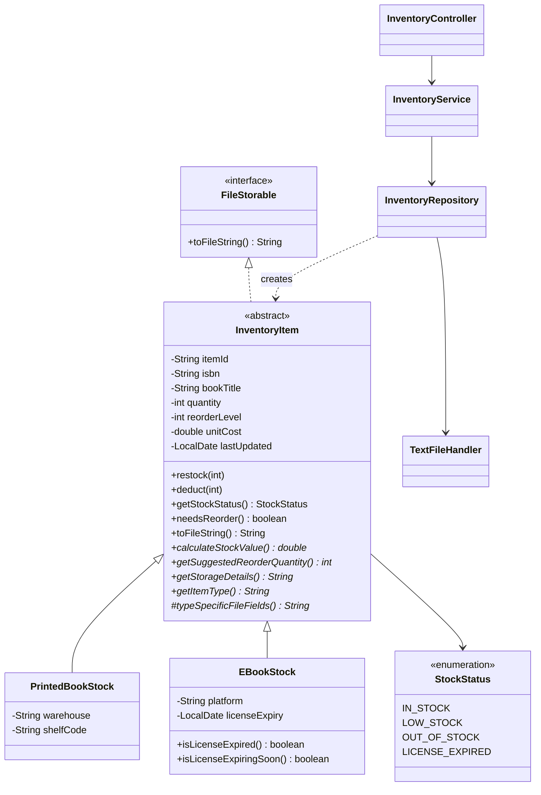

# Online Bookstore Management System

SE1020 Object Oriented Programming project. Spring Boot 4 (`@Controller` + Thymeleaf), Java 26, data stored in `.txt` files.

| # | Module | Owner | Status |
|---|--------|-------|--------|
| 1 | Book Management | | Placeholder |
| 2 | Customer Management | | Placeholder |
| 3 | Inventory Management | Udara | Done |
| 4 | Order / Sales Management | | Placeholder |
| 5 | Supplier Management | | Placeholder |
| 6 | Staff / User Management | | Placeholder |

## Run it

1. Open the folder in IntelliJ IDEA (2026.1 or newer for Java 26), and let Maven import.
2. File > Project Structure > SDK: pick JDK 26.
3. Run `BookstoreApplication`.
4. Open http://localhost:8080

Data files live in `data/` at the project root (set by `app.data-dir` in `application.properties`).
IntelliJ's working directory must be the project root, which is the default.

## Inventory Management (Component 3)

### CRUD
| Operation | Page | URL |
|-----------|------|-----|
| Create | Add stock item form | `GET/POST /inventory/new`, `POST /inventory` |
| Read | Inventory list with search + filters, item details page | `GET /inventory`, `GET /inventory/{id}` |
| Update | Edit details form, adjust stock (restock/remove) | `POST /inventory/{id}/edit`, `POST /inventory/{id}/adjust` |
| Delete | Delete button (list and details page) | `POST /inventory/{id}/delete` |

### UIs
Inventory list, add/edit form, item details with stock adjustment, plus the shared dashboard.

### OOP concepts (for the viva)
- **Encapsulation**: `InventoryItem` has only private fields. Setters validate (no negative quantity or cost). Quantity changes go through `restock()` / `deduct()`.
- **Abstraction**: `InventoryItem` is abstract, and `FileStorable` is an interface. Controllers and services work with `InventoryItem` without caring which subclass it is.
- **Inheritance**: `PrintedBookStock` and `EBookStock` extend `InventoryItem`.
- **Polymorphism**, which is the method overriding:
  - `calculateStockValue()`: printed = qty × cost; e-book = 0 if the license expired.
  - `getSuggestedReorderQuantity()`: printed rounds up to cartons of 10; e-book is the exact license count.
  - `getStockStatus()`: e-book adds `LICENSE_EXPIRED`.
  - `deduct()`: e-book blocks removal when the license expired.
  - `InventorySummary` sums `calculateStockValue()` over a mixed list, and each object runs its own version.
- **Template method**: `toFileString()` (final, in the parent) writes the common fields and calls the subclass's `typeSpecificFileFields()`.

### File handling
- `TextFileHandler` (shared): `BufferedReader` to read, `BufferedWriter` to write, and writes go to a temp file first and then get swapped in so the file is never half-written.
- `InventoryRepository`: reads `inventory.txt` line by line, splits on `|`, and builds the right subclass using a `switch` on the type field. It saves by rewriting the file with each item's `toFileString()`. Methods are `synchronized`.

### inventory.txt format
```
TYPE|ID|ISBN|TITLE|QTY|REORDER_LEVEL|UNIT_COST|LAST_UPDATED|extra1|extra2
PRINTED|INV001|978-0-13-468599-1|Effective Java|24|10|4850.00|2026-09-20|Warehouse A|A-03
EBOOK|INV005|978-0-13-235088-4|Clean Code|15|5|3200.00|2026-09-15|Kindle Store|2027-06-30
```
For printed stock, extra1 and extra2 are warehouse and shelf code. For e-books, they are platform and license expiry.

### Class diagram


## Project structure
```
com.bookstore
├── BookstoreApplication
├── common
│   ├── storage   FileStorable, TextFileHandler     (shared, use these!)
│   └── web       DashboardController, DashboardModule, NavigationAdvice
└── inventory
    ├── model       InventoryItem, PrintedBookStock, EBookStock, StockStatus, InventorySummary
    ├── dto         InventoryForm
    ├── repository  InventoryRepository
    ├── service     InventoryService
    ├── controller  InventoryController
    └── exception   InventoryNotFoundException, DuplicateStockException
```

## For teammates: adding your module
1. Create your own package, like `com.bookstore.books`, with the same model / repository / service / controller layout.
2. Reuse `TextFileHandler` for file I/O and implement `FileStorable` in your model. Put your file in `data/` (for example `books.txt`).
3. In `DashboardModule.ALL`, change your module's `url` to your controller path and set `implemented` to `true`.
4. In your templates, reuse the layout: `th:replace="~{fragments/layout :: head('Title')}"`, `:: sidebar`, `:: flash`, and add a `@ModelAttribute("active")` that returns your module key so the sidebar highlights it.
5. Work on your own branch and open a pull request, so the commit history shows your work.
